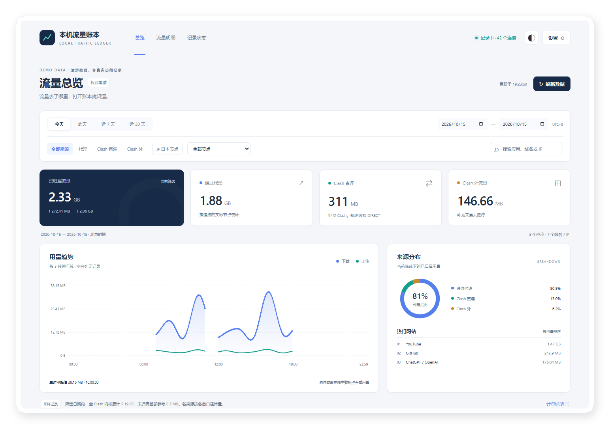
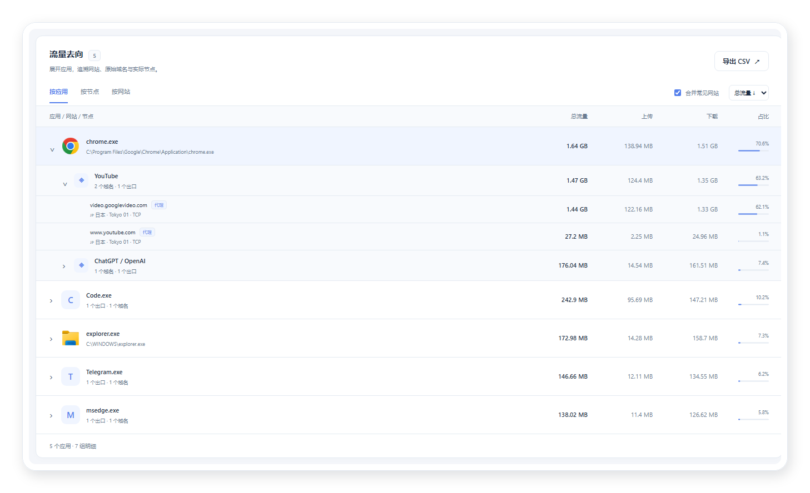
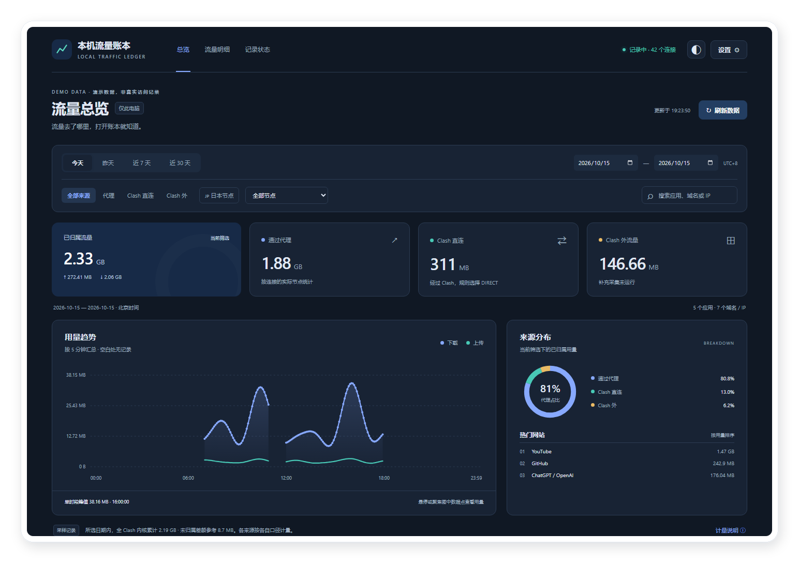
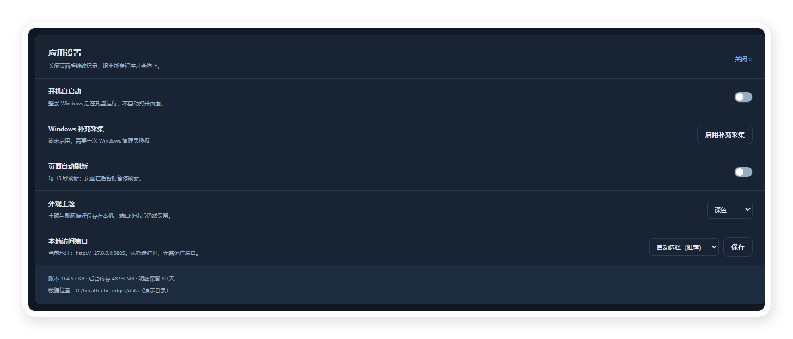

<div align="center">


# 本机流量账本 Local Traffic Ledger

### 流量去了哪里，打开账本就知道。

为 Windows 电脑留一本本地流量账本。<br>
按应用、网站与实际代理节点查看用量，关掉页面也继续记录。


**[下载 Windows 便携版](https://github.com/CarlosZ16420/LocalTrafficLedger/releases/latest)** · [反馈问题](https://github.com/CarlosZ16420/LocalTrafficLedger/issues) · [更新日志](CHANGELOG.md)

[快速开始](#快速开始) · [功能介绍](#功能介绍) · [常见问题](#常见问题) · [开发与开源](#开发与开源) · [友链](#友链)

</div>

哪个应用用了最多流量？看视频走了哪个节点？昨天的用量还能查到吗？

本机流量账本读取 Clash Verge / Mihomo 的本机连接统计，将用量持续保存在 SQLite 中。
从总览进入应用，再展开网站、原始域名和当时的实际节点，逐层查清流量去向。

**不需要账号，不上传账本，没有遥测；程序、网页和图标都在本机运行。**

[](assets/readme/dashboard-light-showcase.zh-CN.png)

> 所有展示图均使用隔离测试宿主生成的虚构数据，不包含真实用户的访问记录。当前仅支持 Windows；LINUX DO 是社区友情链接。

## 快速开始

1. 在 [Releases](https://github.com/CarlosZ16420/LocalTrafficLedger/releases/latest) 下载 `LocalTrafficLedger-v1.2.0-win-x64-portable.zip`，**完整解压到可写文件夹**。
2. 双击 `LocalTrafficLedger.exe`。程序进入系统托盘，并用默认浏览器打开仪表盘。
3. 正常使用网络，稍后刷新即可查看新记录。关闭网页不会停止采集，点击托盘图标可再次打开。

无需安装，不需要 Node.js、Python、Docker 或 .NET SDK。运行要求为 **Windows 10/11 x64、.NET Framework 4.8**；Windows 11 自带该运行时，较旧的 Windows 10 需先确认已安装。

每个 ZIP 附同名 `.sha256`，可用 `Get-FileHash` 核对。GitHub 自动生成的 **Source code** 是源码，使用应用请下载上面的便携 ZIP。

默认通过本机命名管道连接兼容的 Clash Verge / Mihomo，不修改节点、代理、路由或 Clash 配置。
如需记录未经过 Clash 的应用，到“设置 → Windows 补充采集”完成一次管理员授权。

## 功能介绍

### 一眼看懂用量，再逐层查清去向

| 你想知道什么 | 如何查看 |
| --- | --- |
| 今天或一段时间用了多少 | 今天、昨天、近 7 天、近 30 天及自定义日期，统一按北京时间统计 |
| 什么时候用得最多 | 上下行趋势、单时段峰值；悬停查看用量，键盘左右切换数据点 |
| 流量从哪里经过 | 代理、Clash 直连、Clash 外的独立用量与占比 |
| 哪个应用、网站或节点用得多 | 切换三种明细视图，按总量、下载、上传或名称排序 |
| 具体访问了什么，走了哪个节点 | 展开应用 → 网站分组 → 原始域名与实际节点；支持日本节点筛选、指定节点与搜索 |
| 需要自己留档或继续分析 | 按当前日期和筛选导出 CSV；采集启动、中断和恢复另有状态记录 |

[](assets/readme/details-showcase.zh-CN.png)

### 白天清楚，夜间舒适

支持浅色、深色和跟随系统。界面适配窄窗口，显示筛选摘要并可一键清除。
主题和页面自动刷新偏好保存在本机设置中，更换端口后仍会保留。

<details>
<summary>查看深色界面</summary>

[](assets/readme/dashboard-dark-showcase.zh-CN.png)

</details>

### 解压即用，设置也容易找到

- **开机自启动：** 网页右上角“设置”，或托盘右键 →“设置 → 开机自启动”。登录 Windows 后只在托盘运行。便携版首次使用默认关闭。
- **自动空闲端口：** 默认让 Windows 分配可用端口，从托盘一键打开即可；也可以指定端口，被占用时自动回退。
- **数据随程序携带：** 便携版写入 EXE 相邻的 `data/`。退出后可把整个目录一起备份或搬迁。

[](assets/readme/settings-showcase.zh-CN.png)

## 常见问题

<details>
<summary>能恢复安装前的流量，或与运营商账单逐字节对齐吗？</summary>

不能。统计从运行后开始。Mihomo 活动连接采用采样方式，短连接、末段和未监控时段可能无法归属。
内核总量与明细的差额单独显示，不分摊给节点。Windows ETW 和 Mihomo 的字节口径不同。
趋势图显示时段用量，不是瞬时网速。默认保留 90 天明细，详见 [计量说明](docs/MEASUREMENT.md)。

</details>

<details>
<summary>为什么 Clash 外流量没有域名，或开启 TUN 后暂停？</summary>

Windows 补充采集只消费网络事件，通常只能确定进程和 IP，不解密 HTTPS、不保存数据包。
TUN 开启或主采集器状态不明时暂停这部分计量，以免重复计数。没有域名的连接会保留 IP。

</details>

<details>
<summary>本地地址会不会与其他软件冲突？为什么不能从另一台电脑打开？</summary>

默认在绑定时由 Windows 直接分配空闲端口，省去固定使用 8793 的冲突。
若自行指定的端口被占用，程序会回退到空闲端口，在设置中显示实际地址。
端口更改下次重启生效；不需要收藏带端口的旧地址，直接双击程序或点击托盘图标。

页面只监听 `127.0.0.1`，仅此电脑可访问。随机入口建立本机会话，设置操作也有请求校验。
分享 `runtime.json` 会泄露当前访问凭据，请勿上传；源码和便携发行包均不包含此文件。

</details>

<details>
<summary>如何更新、搬家、备份或卸载？</summary>

更新前退出托盘程序，用新版程序文件替换旧文件，**保留 `data/`**。
备份前退出程序，再复制整个目录；不要只复制正在写入的 `.db`。

搬家前关闭自启动并退出，移动整个目录后再开启。忘记关闭时，设置中会提示修复旧自启动路径。
启用过 Windows 补充采集的，移动后需重新授权以更新其任务路径。

卸载前关闭自启动；启用过补充采集的，先以管理员身份运行 `LocalTrafficLedger.exe --disable-etw`，再从托盘退出。
然后删除程序文件夹。删除 `data/` 会一并删除历史账本；想保留历史可先单独备份。

</details>

<details>
<summary>是否支持 Linux、告警或秒级网速监控？</summary>

当前仅支持 Windows 10/11 x64，主要用途是本地历史用量查询。
尚未提供 Linux／macOS、秒级带宽仪表、阈值告警、多机器监控和时段同比环比。
本轮界面对照与后续差距见 [UI 评估](docs/UI-REVIEW.md)。

</details>

## 开发与开源

**本项目由 AI（OpenAI Codex）根据维护者需求完成开发，包括代码实现、界面迭代、测试和文档。**
维护者 CarlosZ16420 提出需求、参与体验反馈并负责发布；项目采用 [MIT License](LICENSE)。

```powershell
.\build.ps1 -Test
.\package.ps1
```

源码构建需 Windows 与 .NET SDK；原生测试和浏览器验收方法见 [开发说明](docs/DEVELOPMENT.md)。
展示图工程复用了 [Hamster Archiver](https://github.com/CarlosZ16420/hamster-archiver) 的圆角透明阴影工具，
可从 [截图工程](tools/showcase/README.md) 重新生成。计量实现参考官方 [Mihomo API](https://wiki.metacubex.one/api/) 与 Windows ETW 文档。

欢迎 [提交问题或建议](https://github.com/CarlosZ16420/LocalTrafficLedger/issues)，请附版本、操作步骤与错误信息，并隐去私人路径、域名和节点名称。

## 友链

- [LINUX DO — 新的理想型社区](https://linux.do/)
- [仓鼠症大结局 Hamster Archiver](https://github.com/CarlosZ16420/hamster-archiver)
